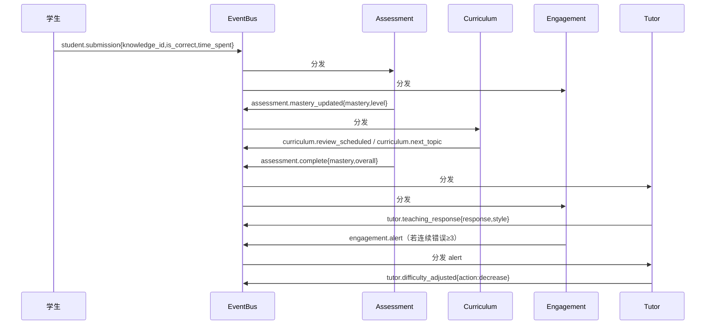

# 架构全景与设计取舍

## 1. 问题域：为什么需要多 Agent

在线教育的老问题：

- 学生做题错了 → 系统只会「再试一次」或直接给答案 → 学生抄完就走，什么都没学会。
- 所有学生走同一条课程路径 → 学霸被拖慢、学困生被劝退。
- 老师端看不到「这个学生到底卡在哪个知识点」。

拆成可计算的目标，就是四件事：

1. **知道他会不会**（掌握度评估，而且要能随答题动态更新）
2. **知道怎么教他**（提问策略、难度自适应）
3. **知道下一步学什么、什么时候复习**（路径规划 + 间隔重复）
4. **知道他还想不想学**（挫败/厌倦/疲劳的识别与干预）

这四件事的**数据、时机、失败模式**完全不同，硬塞进一个类里必然变成 800 行的 `do_everything()`。
所以拆成 5 个 Agent，每个只对一种「专业判断」负责。

### 为什么单 Agent 不够

| 维度 | 单 Agent | 多 Agent |
|---|---|---|
| 上下文 | 一份 prompt 里塞评估+教学+排课，互相干扰 | 每个 Agent 只看自己需要的事件，上下文隔离 |
| 演进 | 改教学策略会碰到评估逻辑 | 新增策略只改一个文件 |
| 并行 | 串行，且 LLM 调用排队 | 同一事件可并发分发给多个 Agent |
| 可测 | 只能端到端测 | 每个 Agent 可单独测（喂一个事件，断言发什么事件） |
| 故障 | 一处异常全链路挂 | 一个 handler 异常被隔离，其余照常 |

> 注意：多 Agent **不是**免费午餐。代价是「分布式系统的那一套问题」——顺序、幂等、循环、可观测性。
> 本项目的教学价值，一半在算法，一半在**如何把代价控制住**。

---

## 2. 三种编排模式，为什么选 Mesh

| 模式 | 结构 | 优点 | 致命弱点 | 典型场景 |
|---|---|---|---|---|
| **Supervisor** | 一个中心调度者，按顺序调用子 Agent | 流程清晰、易调试 | 中心是瓶颈；子 Agent 之间不能直接对话 | 固定流水线（写报告、做数据分析） |
| **Pipeline** | A→B→C 单向流转 | 最简单 | 不能回退、不能并行、加一步要改链路 | 数据清洗、ETL |
| **Mesh + 事件驱动** ✅ | 每个 Agent 订阅事件、发布事件，无中心 | 双向、异步、松耦合、易扩展 | 调试难、有循环风险、顺序不直观 | **教学对话**：Tutor 随时要 Hint，Assessment 随时要 Curriculum 改路径 |

关键判断依据：**Agent 之间是不是「谁需要谁就叫」的双向关系？**

- 教学场景：Tutor 讲到一半发现学生卡住 → 叫 Hint；Assessment 发现薄弱 → 通知 Curriculum 改路径；Engagement 发现挫败 → 通知 Tutor 降难度。**是双向的、事件驱动的。**
- 如果强行用 Supervisor，Supervisor 会变成「上帝对象」，所有交互都要经过它，每加一条交互就改一次中心。

> **「教育场景的交互是双向、异步、不可预排的，Supervisor 的中心调度会成为瓶颈和耦合点；Mesh 让每个 Agent 只声明『我关心什么』，新增 Agent 不改旧代码，符合开闭原则。」**

---

## 3. 五个 Agent：输入、输出、边界

| Agent | 一句话职责 | 订阅（输入） | 发布（输出） | 不该做的事 |
|---|---|---|---|---|
| **Assessment** 评估 | 用 BKT 更新每个知识点的掌握度 | `student.submission`、`student.question` | `assessment.mastery_updated`、`assessment.weakness_detected`、`assessment.complete` | 不生成教学内容 |
| **Tutor** 教学 | 苏格拉底式提问，按掌握度调难度 | `assessment.complete`、`student.message`、`hint.response`、`engagement.alert` | `tutor.teaching_response`、`tutor.hint_needed`、`tutor.difficulty_adjusted` | 不自己算掌握度、不自己排复习 |
| **Hint** 提示 | 三级提示（暗示→引导→答案） | `tutor.hint_needed` | `hint.response` | 不判断该不该教 |
| **Curriculum** 课程 | 拓扑序排路径 + SM-2 排复习 | `assessment.mastery_updated`、`assessment.weakness_detected`、`engagement.pace_adjustment` | `curriculum.next_topic`、`curriculum.path_updated`、`curriculum.review_scheduled` | 不生成对话 |
| **Engagement** 互动 | 识别学习状态并干预 | `student.submission`、`assessment.complete`、`student.message` | `engagement.alert`、`engagement.encouragement`、`engagement.pace_adjustment` | 不改掌握度 |

**共享状态只有一个**：`learner_models: dict[str, LearnerModel]`，由编排器创建、注入给所有 Agent。
所有 Agent 读它；**只有 Assessment 写掌握度**（单写者），Curriculum 写自己的复习条目。这条纪律在第 14 章会变成「乐观锁」。

---

## 4. 五条事件流

### 4.1 提交答案（主链路）

注意顺序：`mastery_updated` 在 `assessment.complete` **之前**发。
原因：细粒度事件给「关心数值」的 Agent（Curriculum），汇总事件给「关心上下文」的 Agent（Tutor / Engagement）。改顺序会改变行为，第 6 章会专门验证。

### 4.2 学生提问

`student.question` → Assessment（读当前掌握度，发 `assessment.complete`）→ Tutor（发 `teaching_response`）。

### 4.3 卡住 → 分级提示

Tutor 统计「同一知识点连续答错次数」，`attempts >= 2` 时不再直接讲，而是发 `tutor.hint_needed`
→ Hint 决定级别（1/2/3）→ 发 `hint.response` → Tutor 转发成 `teaching_response{teaching_style:"hint"}`。

> 为什么不让 Tutor 直接生成提示？**职责分离**：Hint 的升级策略需要独立调参和独立评估（引导率指标），混在 Tutor 里就没法单独优化。

### 4.4 挫败 / 厌倦

Engagement 检测到连续 3 错 → `engagement.alert{alert_type:frustration}` + `engagement.pace_adjustment{slow_down}`
→ Tutor 收到 alert 降难度；Curriculum 收到 pace 放慢排期。

### 4.5 复习排期

`assessment.mastery_updated` → Curriculum 把 mastery 映射成 SM-2 的 quality(0–5) → 更新 `ReviewItem` → 有到期项就发 `curriculum.review_scheduled`。

---

## 5. 五条设计决策

| # | 决策 | 备选 | 为什么这么选 | 代价 / 缓解 |
|---|---|---|---|---|
| 1 | 事件总线（进程内 pub/sub） | 直接方法调用、消息队列 | 解耦、可并发、易加 Agent | 调试难 → `correlation_id` + 事件历史 |
| 2 | 掌握度用 BKT | 正确率、IRT、DKT | 能建模「猜对/失误」，可在线更新，参数少可解释 | 假设较强 → 第 2 章讨论局限 |
| 3 | 复习用 SM-2 | Leitner、FSRS | 公式简单、业界验证（Anki）、易讲清 | 粒度粗 → 第 4 章讨论 |
| 4 | 状态放内存 dict | 直接上 Postgres | 先跑通闭环，降低环境门槛 | 重启丢状态 → 第 14 章迁移 |
| 5 | 先 Mock LLM | 直接接 GPT | 确定性、零成本、可离线测 | 效果不真实 → 第 12 章替换 |

> 「代价」。**能说出代价和缓解方案，比说优点更加分。**

---

## 6. 三个反模式（现在就要避开）

1. **事件地狱**：任何两个 Agent 之间都用事件通信，包括「取一个值」。
   → 规则：**只有「通知发生了某事」才用事件；「我要一个返回值」用方法调用。**
2. **隐式耦合**：Tutor 直接读 `curriculum._review_items` 这种私有字段。
   → 规则：跨 Agent 只通过事件 data 或 `LearnerModel` 的公开方法交互。
3. **无限级联**：A 发事件 → B 处理后又发同类事件 → A 再处理……
   → 规则：事件只能「向上」流动（数据更新 → 决策 → 展示），且第 1 章要给总线加**深度上限**。

---

## 7. 自测题

1. 如果产品要求「老师端实时看到全班每个学生的掌握度热力图」，Mesh 架构需要改什么？加在哪里最合适？
2. 为什么 `assessment.mastery_updated` 和 `assessment.complete` 要分成两个事件？合成一个会丢失什么？
3. 假设 Engagement 挂了（抛异常），学生提交答案还能得到教学回复吗？为什么？
4. 「新增第 6 个 Agent 不改旧代码」——请指出本设计中**哪些地方会破坏这个承诺**。
5. Supervisor 模式在什么条件下反而更优？举一个本项目的子场景。
6. 「为什么 Tutor 不直接调用 Hint，而要发事件？」
7. 这套架构**最脆弱的环节**是哪里，为什么。

---